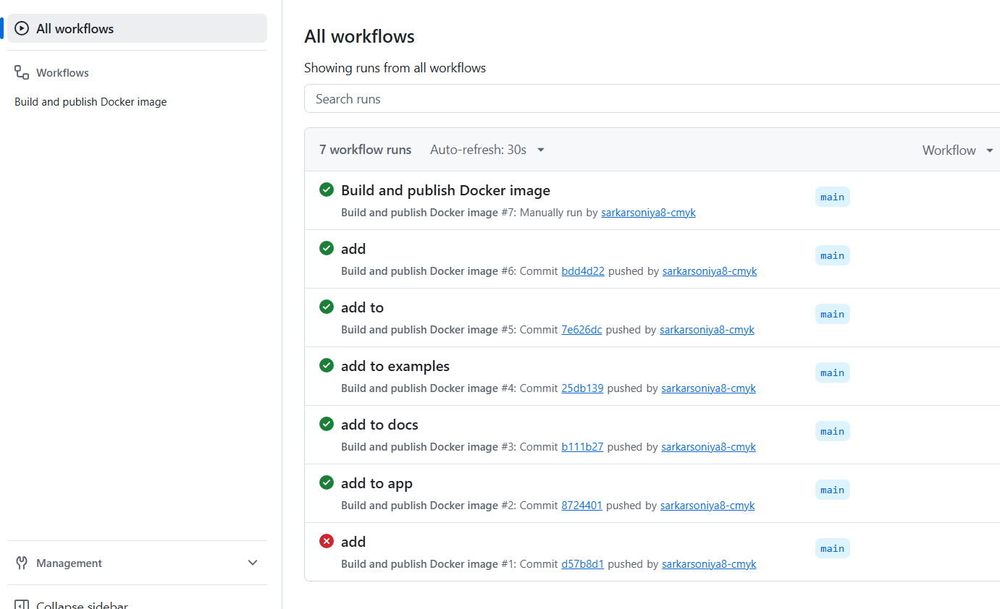
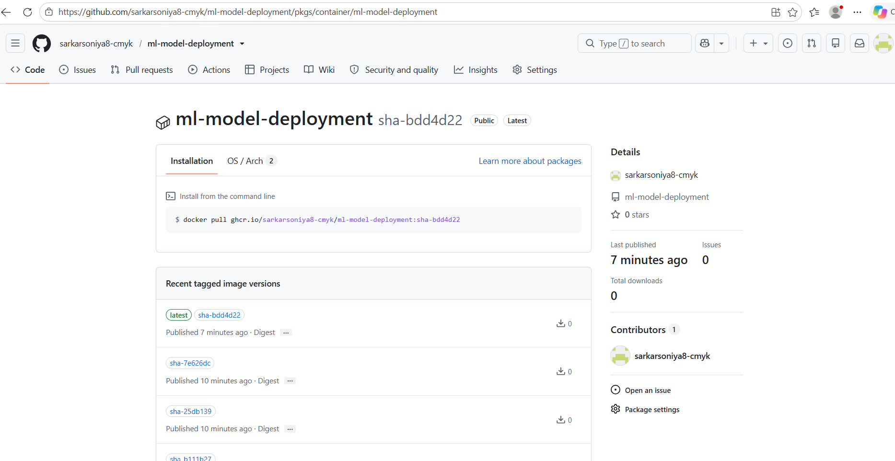
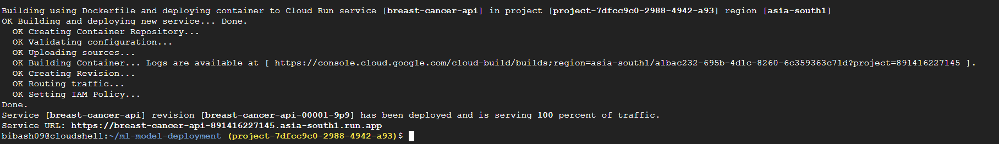
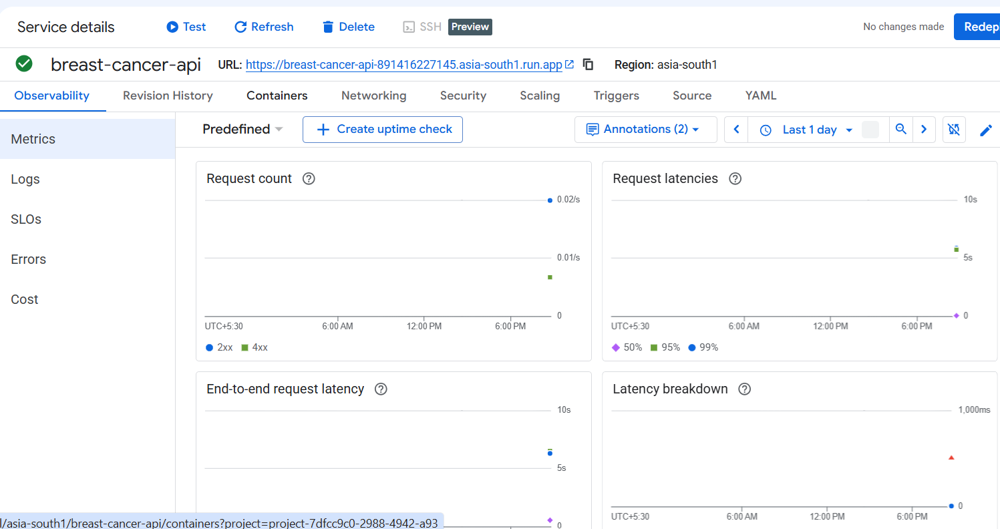
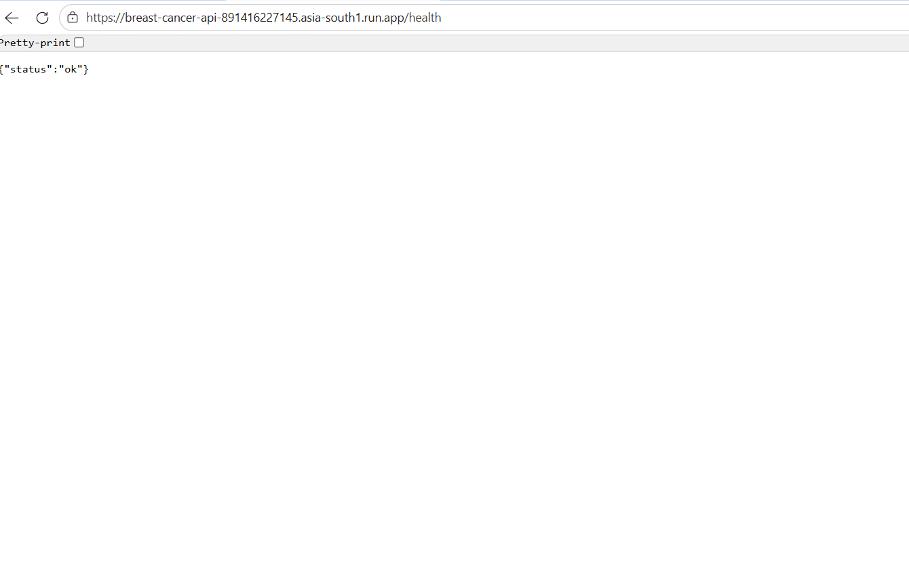
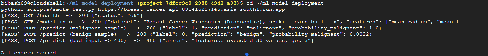

# Deploying a Machine Learning Model

A trained breast-cancer classifier served as a REST API (Flask + gunicorn), packaged in Docker, published as a container image and deployed to Google Cloud Run.

## Deliverables
| Deliverable | Where |
|---|---|
| Docker image definition | [`Dockerfile`](Dockerfile) |
| Published Docker image | `ghcr.io/sarkarsoniya8-cmyk/ml-model-deployment:latest` ([package page](https://github.com/sarkarsoniya8-cmyk/ml-model-deployment/pkgs/container/ml-model-deployment)) |
| Deployed API (Google Cloud Run, region asia-south1) | https://breast-cancer-api-891416227145.asia-south1.run.app (shut down after testing to avoid charges; see the screenshots below) |
| Deployment and API documentation | [`docs/deployment_guide.md`](docs/deployment_guide.md) |
| API code and model training | [`app/main.py`](app/main.py), [`train.py`](train.py) |
| Tests | [`tests/test_api.py`](tests/test_api.py) (12 tests) |

## Quick start

**Option 1: run the published image (no build needed)**
```bash
docker run --rm -p 8080:8080 ghcr.io/sarkarsoniya8-cmyk/ml-model-deployment:latest
```

**Option 2: build the image yourself**
```bash
docker build -t breast-cancer-api:1.0 .
docker run --rm -p 8080:8080 breast-cancer-api:1.0
```

**Test the API** (in a second terminal, with either option running)
```bash
curl -X POST http://localhost:8080/predict -H "Content-Type: application/json" -d @examples/sample_malignant.json
```
Expected response: `{"label": 1, "prediction": "malignant", "probability_malignant": 1.0}`

## Endpoints
`GET /health`, `GET /model-info`, `POST /predict`, `POST /predict/batch`. Full request and response details are in the [deployment guide](docs/deployment_guide.md).

## Model
StandardScaler + Logistic Regression on the Breast Cancer Wisconsin (Diagnostic) dataset. Test accuracy 0.965, recall 0.929, F1 0.951. Educational demo, not a medical device.

## Screenshots
**Image built and published by GitHub Actions**



**Public container image on GitHub Packages**



**Deployment to Cloud Run**



**Cloud Run service running**



**Live health check**



**Smoke test against the live URL: all 5 checks passed**


